# LAPORAN PROYEK WEBSITE PEMBELAJARAN
# Ruang Peluang
**Pembuatan Website Berisi Materi Mata Pelajaran Matematika: Peluang Suatu Kejadian dan Peluang Kejadian Majemuk**

| Identitas | Isian |
|---|---|
| Judul/nama website | Ruang Peluang |
| Mata pelajaran dan topik | Matematika — Peluang Suatu Kejadian dan Peluang Kejadian Majemuk |
| Nama kelompok / siswa | **[ISI: nama kelompok atau nama siswa]** |
| Nama anggota dan kelas | **[ISI: nama setiap anggota dan kelas]** (acuan sementara dari brief: kelas XII/X, perlu dikonfirmasi) |
| Nama guru | **[ISI: nama guru pengampu]** |
| Tahun pelajaran | **[ISI: tahun pelajaran]** (acuan sementara dari brief: 2025/2026, perlu dikonfirmasi karena pengerjaan berlangsung pada Oktober 2026) |
| Nama sekolah | **[ISI: nama sekolah]** |

Disusun 23 Oktober 2026 (Pertemuan 1), dilengkapi 27 Oktober 2026 (Pertemuan 2–5).

> **Catatan penyusunan.** Semua bagian bertanda **[ISI: …]** sengaja dikosongkan karena informasinya tidak ada di berkas proyek (identitas, nama guru, tanggal pertemuan kelas, masukan guru, pembagian tugas, tautan publikasi). Daftar lengkapnya ada di Lampiran H. Isi laporan selain itu bersumber dari berkas proyek, riwayat Git, dan hasil pengujian yang dapat diulang (`npm test`, `npm run test:final`). Hal yang belum dilakukan ditulis apa adanya, termasuk di bagian Evaluasi (6.6). Tidak ada masukan guru, uji pengguna, atau nilai rubrik yang diklaim.

---

# BAB I — PENDAHULUAN

## 1.1 Latar Belakang
Belajar peluang membutuhkan pemahaman tentang semua hasil yang mungkin dan hasil yang memenuhi syarat suatu kejadian. Menghafal rumus tanpa memahami ruang sampel dapat menghasilkan jawaban keliru, khususnya pada gabungan yang memiliki irisan. Ruang Peluang menggunakan himpunan titik dan manipulasi skenario agar setiap hasil yang dihitung dapat diperiksa langsung.

## 1.2 Rumusan Masalah
Bagaimana siswa menentukan ruang sampel yang tepat? Bagaimana diagram menunjukkan perbedaan gabungan, irisan, dan komplemen? Bagaimana membedakan saling lepas, independensi, dan ketergantungan? Bagaimana menyediakan latihan serta evaluasi yang menjelaskan alasan matematis?

## 1.3 Tujuan
Menyediakan pembelajaran visual berbahasa Indonesia, menghubungkan rumus dan anggota himpunan, mengembangkan percobaan empiris, serta menyediakan penjelasan bertahap dan dokumentasi proyek yang dapat ditinjau guru.

## 1.4 Manfaat
Siswa dapat menguji dugaan melalui perubahan skenario. Guru memperoleh alat demonstrasi dan rujukan materi. Pengembang berlatih memisahkan model matematika dari antarmuka dan memeriksa hasil secara otomatis.

## 1.5 Sasaran Pengguna
Siswa SMA/SMK X–XII, siswa SMP IX pada materi pengantar, serta guru matematika. Antarmuka menyediakan kontrol keyboard, label bahasa Indonesia, dan pengurangan gerak untuk kebutuhan aksesibilitas.

## 1.6 Pembagian Tugas Anggota
Proyek ini dilaporkan sebagai proyek **[ISI: individu / kelompok]**. Jika berkelompok, pembagian tugas dicatat di Lampiran C.

---

# BAB II — PERENCANAAN MATERI (PERTEMUAN 1)

## 2.1 Mata Pelajaran dan Topik
Matematika: peluang suatu kejadian dan peluang kejadian majemuk. Nama website adalah Ruang Peluang. Lingkup dibatasi pada ruang sampel berhingga; peluang klasik dipakai ketika hasil elementer sama mungkin. Persetujuan topik oleh guru: **[ISI: tanggal/keterangan persetujuan guru]**.

## 2.2 Alasan Pemilihan Materi
Koin, dadu, bola, kartu, serta susunan tempat duduk menawarkan konteks konkret. Diagram Venn memudahkan pemeriksaan tumpang tindih. Percobaan berulang pada setiap materi memperlihatkan variasi acak, sehingga nilai harapan tidak disalahartikan sebagai hasil yang pasti.

## 2.3 Tujuan Pembelajaran
Siswa menyusun ruang sampel; menghitung peluang dan komplemen; menafsirkan frekuensi relatif serta harapan; menggunakan aturan penjumlahan dengan benar; membedakan independensi dan kondisi; serta mengomunikasikan alasan solusi tiga latihan kontekstual.

## 2.4 Daftar Materi/Submateri
| No. | Materi di situs | Isi utama | Rute |
|---|---|---|---|
| 1 | Ruang sampel | Percobaan, ruang sampel, titik sampel, kejadian sebagai himpunan bagian | `/materi/ruang-sampel` |
| 2 | Peluang & komplemen | P(A) = n(A)/n(S), batas 0 ≤ P(A) ≤ 1 (mustahil dan pasti), peluang komplemen | `/materi/peluang-komplemen` |
| 3 | Frekuensi kejadian | Frekuensi relatif (pecahan dan persen), frekuensi harapan | `/materi/frekuensi-kejadian` |
| 4 | Kejadian majemuk | Gabungan dan irisan, saling lepas dan tidak saling lepas | `/materi/kejadian-majemuk` |
| 5 | Bebas & bersyarat | Peluang bersyarat, aturan perkalian, kejadian saling bebas | `/materi/bebas-bersyarat` |

Latihan (halaman `/latihan`): kantong 15 bola (merah atau hijau); kartu As atau King dari 52 kartu bridge; delapan orang berbeda duduk berselang-seling di meja bundar. Rencana awal terdapat pada `docs/DRAF_PERTEMUAN_1.md`.

## 2.5 Rencana Sumber Referensi
Rencana awal: modul Kemendikbud sebagai rujukan konteks sekolah dan OpenStax sebagai rujukan pembanding definisi. Pada tahap validasi (Bab V) rencana ini diperluas menjadi empat sumber: lembar materi guru, OpenStax 3.1, OpenStax 3.2, dan e-modul Kemendikbud. Setiap sumber memiliki ID, penulis, tahun (bila ada), judul, penerbit, URL dan tanggal akses (untuk sumber daring), cakupan, status pemeriksaan, dan catatan. Daftar lengkap ada di Daftar Pustaka dan pada halaman `/referensi`.

---

# BAB III — KONSEP DAN DESAIN WEBSITE (PERTEMUAN 2)

> **Catatan proses.** Sitemap dan wireframe pada bab ini **disusun ulang dari situs yang sudah dibangun**, bukan sketsa yang dibuat sebelum pengodean. Berkas rancangan awal tidak ada di repositori. Wireframe ditulis sebagai diagram teks agar dapat diperiksa dan diubah bersama kode.

## 3.1 Nama dan Konsep Website
**Ruang Peluang** dengan slogan **"Lihat. Coba. Pahami."** Konsepnya: peluang tidak diajarkan sebagai rumus yang dihafal, melainkan sebagai himpunan titik yang bisa diubah dan dihitung. Urutan belajar setiap materi adalah *eksperimen interaktif → rumus berlabel → contoh → pertanyaan dengan pembahasan → latihan terkait → sumber*. Dadu menjadi benda utama karena ruang sampelnya kecil (enam titik) sehingga setiap hasil dapat ditunjuk satu per satu.

Tujuan website: membantu siswa menyusun ruang sampel dengan benar, membedakan gabungan, irisan, dan komplemen, serta membedakan saling lepas dari saling bebas.

## 3.2 Target Pengguna dan Gaya Penyajian
Pengguna utama adalah siswa SMA/SMK kelas X–XII; siswa SMP kelas IX untuk pengantar ruang sampel; guru sebagai pendamping dan pengguna demonstrasi. Gaya penyajian:

- Bahasa Indonesia, kalimat pendek, istilah matematika dijelaskan saat pertama muncul.
- Satu gagasan per halaman materi, dengan rumus dipisah menjadi kartu berlabel (misalnya "Saling lepas (A ∩ B = ∅)") agar tidak tertukar.
- Pembahasan soal disembunyikan di balik tombol "Lihat pembahasan" supaya siswa mencoba dahulu.
- Gerak dapat dikurangi lewat pilihan **Mode tampilan** (Interaktif penuh, Tenang, Fokus ujian) dan menghormati pengaturan *reduced motion* pada perangkat.

## 3.3 Struktur Halaman / Sitemap
```
Ruang Peluang
├── Beranda  (/)
│   ├── #beranda   Hero: "Peluang bukan sekadar angka."
│   ├── #dadu      Dadu yang Bergulir (dadu 3D mengikuti gulir)
│   ├── #lab       Lab diagram himpunan (ganjil & prima / ganjil & genap)
│   └── #materi    Daftar lima materi (pratinjau + "Coba animasi")
├── Materi  (/materi/[slug])  × 5
│   ├── ruang-sampel
│   ├── peluang-komplemen
│   ├── frekuensi-kejadian
│   ├── kejadian-majemuk
│   └── bebas-bersyarat
├── Latihan  (/latihan)       3 soal + pembahasan
├── Referensi  (/referensi)   daftar pustaka, ilustrasi, perangkat lunak, arti status
└── Halaman pengembang
    ├── /styleguide           sistem desain (dari footer dan tombol panah di header)
    └── /prototype            prototipe efek 3D (tidak ada di menu)
```

| Halaman | Fungsi | Dihubungkan dari |
|---|---|---|
| Beranda | Pengantar, dadu 3D, lab Venn, daftar materi | Semua halaman (logo) |
| Materi (5) | Eksperimen, rumus, contoh, pertanyaan, latihan terkait, sumber | Daftar materi di beranda; tombol sebelumnya/berikutnya antar materi |
| Latihan | Tiga soal dengan pembahasan langkah demi langkah | Header, footer, dan bagian "Latihan untuk materi ini" pada materi 1 dan 4 |
| Referensi | Daftar pustaka dan status pemeriksaan | Header, footer, dan blok "Sumber" di setiap materi dan latihan |
| Styleguide, Prototype | Dokumentasi desain dan prototipe | Footer / tombol header (styleguide); alamat langsung (prototype) |

Jalur belajar yang disarankan: Beranda → Materi 1 sampai 5 berurutan → Latihan → Referensi.

## 3.4 Wireframe / Sketsa

**Beranda (desktop)**
```
+--------------------------------------------------------------------------+
| (●●) ruang peluang.  [Beranda] Dadu 3D  Lab Diagram  Materi  Latihan  Referensi  [↗] |
+--------------------------------------------------------------------------+
|                                            Mode tampilan [Interaktif penuh ▾]|
|  Peluang bukan                                                           |
|  sekadar angka.                                                          |
|  Lihat kemungkinan. Mainkan kejadiannya.                                 |
|  [ Mulai bereksplorasi ↗ ]                                               |
+--------------------------------------------------------------------------+
|  Dadu yang Bergulir.                      [teks pengantar]               |
|  [teks tahap 1..4]                 [  dadu 3D berputar mengikuti gulir  ]|
+--------------------------------------------------------------------------+
|  Satu dadu. Banyak kemungkinan.           [teks pengantar]               |
|  [ Venn A·ganjil / B·prima + titik 1–6 ] | 01 PILIH SKENARIO  (• •)      |
|                                          | 02 SOROT KEJADIAN  A∪B A∩B Aᶜ |
|                                          | GABUNGAN  P(A∪B) = 4/6        |
+--------------------------------------------------------------------------+
|  Mulai dari kemungkinan.                                                 |
|  01 Ruang sampel        deskripsi singkat     Pelajari ↗  [Coba animasi +]|
|  02 … 05                                                                  |
+--------------------------------------------------------------------------+
|  ruang peluang.   Materi  Latihan  Referensi   Lihat. Coba. Pahami.  Sistem desain ↗ |
+--------------------------------------------------------------------------+
```

**Halaman materi**
```
+-----------------------------------------------+
| ruang peluang.      Materi  Latihan  Referensi |
+-----------------------------------------------+
| MATERI 04 / 05                                |
| Kejadian majemuk                              |
| [paragraf pengantar]                          |
| +-------------------------------------------+ |
| | COBA SENDIRI / VISUALISASI INTERAKTIF     | |
| | [tombol B = prima | genap] [diagram Venn] | |
| | [A ∪ B | A ∩ B]   hasil: {…}  P = …/6     | |
| +-------------------------------------------+ |
| Hubungkan dengan rumus.                        |
| [ label  ] [ rumus ]  ×  jumlah rumus materi   |
| [contoh]                                       |
| Coba pikirkan.  [pertanyaan] ▸ Lihat pembahasan|
| Latihan untuk materi ini.  [tautan soal]       |
| Sumber  [daftar] [status] [catatan]            |
| ← materi sebelumnya          materi berikutnya →|
+-----------------------------------------------+
| ruang peluang.   Materi  Latihan  Referensi    |
+-----------------------------------------------+
```

**Latihan**
```
| LATIHAN / 03 SOAL        Latihan soal.        [pengantar]
| SOAL 01  Judul soal
| [teks soal]
| [Perlu diketahui: prasyarat / konvensi]   (jika ada)
| ▸ Lihat pembahasan → 1. langkah + rumus  2. …  Jawaban.
| Konsep terkait: [materi] →
| (diulang untuk soal 02 dan 03)
| Sumber  [lembar guru]
```

**Referensi**
```
| REFERENSI / 04 SUMBER     Daftar referensi.   [pengantar]
| 01  Penulis (tahun). Judul. Penerbit. URL. Diakses …
|     [status]  Dipakai untuk: …   Keterangan   Dipakai di: [tautan materi]
| 02 … 04
| Ilustrasi, diagram, dan simulasi   |  Perangkat lunak dan huruf  |  Arti status
```

Pada layar sempit (≤ 760 px) menu header pindah ke baris kedua yang dapat digeser, footer membungkus ke beberapa baris, dan rumus panjang dapat digulir mendatar di dalam kartunya.

## 3.5 Desain Visual
| Unsur | Pilihan | Alasan |
|---|---|---|
| Latar (`--canvas`) | `#F3F0EE` krem hangat | Nyaman dibaca lama; tidak menyilaukan seperti putih murni |
| Kartu (`--lifted`) | `#FCFBFA` | Memisahkan rumus dan eksperimen dari latar tanpa garis tebal |
| Teks (`--ink`) | `#141413` | Kontras tinggi pada latar krem |
| Aksen (`--signal`) | `#CF4500` (jingga bata); `--light` `#F37338` | Menandai hasil yang dipilih, tombol utama, dan tautan aktif |
| Himpunan A / B pada diagram | `#EFB3A3` dan `#F6CF7B` dengan mode *multiply* (logo memakai `#DF5834` dan `#F4AE32`) | Irisan tampak sebagai warna ketiga, sehingga "terhitung dua kali" terlihat |
| Huruf isi dan judul | **Sofia Sans** (isi 450, judul 500, label 700) | Mudah dibaca, ramah di ukuran kecil |
| Huruf angka | **JetBrains Mono** | Angka lebar sama sehingga penghitung tidak bergeser |
| Ikon | Lucide (panah) | Sederhana dan konsisten |
| Sudut | 20 px (kartu), 40 px, lingkaran, pil 999 px | Bentuk bulat mengingatkan pada himpunan |
| Gambar | Tidak ada foto atau gambar pihak ketiga; semua ilustrasi SVG/CSS buatan sendiri | Menghindari masalah hak cipta dan menjaga halaman ringan |

Gerak diagram 650 ms, jalur orbit 1.200 ms. Mode Tenang, Fokus ujian, dan *reduced motion* menampilkan hasil akhir secara langsung. Dokumentasi lengkap: halaman `/styleguide` dan `docs/ARSITEKTUR.md`.

## 3.6 Navigasi dan Fitur
- **Menu header** (beranda): Beranda, Dadu 3D, Lab Diagram, Materi, Latihan, Referensi. Dadu 3D, Lab Diagram, dan Materi berupa jangkar di halaman yang sama dengan penanda bagian aktif; Beranda, Latihan, dan Referensi adalah tautan halaman.
- **Menu header** (halaman lain): Materi, Latihan, Referensi dengan penanda halaman aktif.
- **Footer** di semua halaman: Materi, Latihan, Referensi.
- **Antar materi**: tombol "← sebelumnya" dan "berikutnya →", dengan transisi arah.
- **Tautan lewati navigasi** pada beranda.
- **Fitur belajar**: dadu 3D mengikuti gulir; lab Venn (dua skenario, tiga daerah); lima eksperimen interaktif; rumus KaTeX; pertanyaan dengan pembahasan; tiga latihan dengan pembahasan langkah demi langkah; blok sumber di setiap materi; Mode tampilan.
- **Unduhan**: laporan Markdown tersedia di `/laporan-awal.md` (alamat langsung, belum ada tautan menu).
- **Belum ada** (keputusan lingkup): pencarian, kuis berskor, video.

---

# BAB IV — PROTOTYPE WEBSITE (PERTEMUAN 3)

## 4.1 Teknologi/Platform yang Digunakan
Next.js 16 (App Router) dengan React 19 dan TypeScript *strict*; Tailwind CSS 4 beserta token CSS; KaTeX untuk rumus; Motion (`motion/react`) untuk animasi; Lenis untuk gulir halus; lucide-react untuk ikon. Pengujian: Vitest (unit), ESLint, Playwright (peramban). Font Sofia Sans dan JetBrains Mono melalui `next/font`, diunduh saat build dan dilayani lokal saat runtime. Alasan memilih CSS 3D dan bukan WebGL untuk dadu: nol tambahan ukuran bundel, kompatibel dengan React 19, mudah mengikuti mode tenang (`docs/plans/3d-scrolling-effect.plan.md`).

## 4.2 Fitur yang Sudah Dibuat pada Prototype
1. **Fondasi** (Pertemuan 1): token desain, halaman `/styleguide`, model himpunan dadu (`lib/math.ts`) dengan operasi gabungan, irisan, dan komplemen yang divalidasi.
2. **Beranda** (revisi 23 Oktober 2026, `docs/REVISI_HOMEPAGE.md`): urutan pembuka → diagram himpunan interaktif → daftar lima materi; pratinjau SVG pada hover dan fokus keyboard; lima rute materi dengan penjelasan, rumus, contoh, dan pembahasan singkat.
3. **Prototipe efek 3D** (`/prototype`): dadu 3D yang bergulir mengikuti gulir lalu terbuka menjadi diagram ruang sampel, dengan empat tahap gulir.
4. **Eksperimen per materi**: dadu dan kejadian, komplemen, koin dan grafik frekuensi (hingga 1.000 lemparan), Venn gabungan/irisan, pengambilan dua bola dengan dan tanpa pengembalian.
5. **Gerak halaman**: animasi masuk, transisi antar halaman, dan penghormatan pada mode tenang.

## 4.3 Tangkapan Layar Prototype
Berkas berada di `docs/screenshots/`. Tangkapan layar halaman penuh pada layar lebar tampak panjang karena bagian dadu 3D bersifat *sticky*.

| Gambar | Keterangan |
|---|---|
|  | Fondasi Pertemuan 1, layar 1440 px |
|  | Fondasi pada layar ponsel 360 px |
|  | Halaman sistem desain |
| 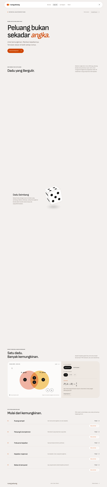 | Beranda setelah revisi |
| 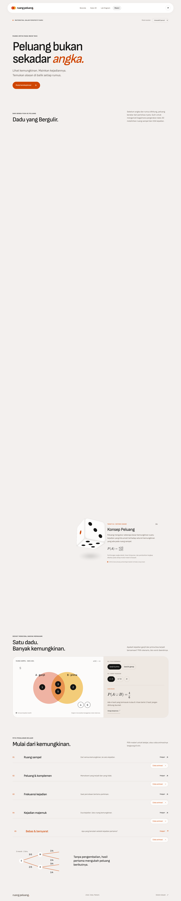 | Pratinjau diagram saat sorot materi |
| 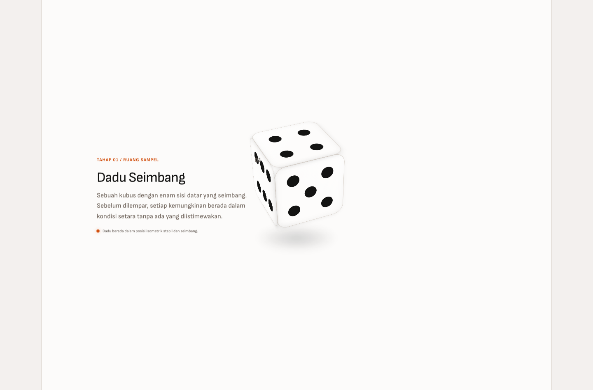 | Prototipe dadu 3D, 1440 px |
| 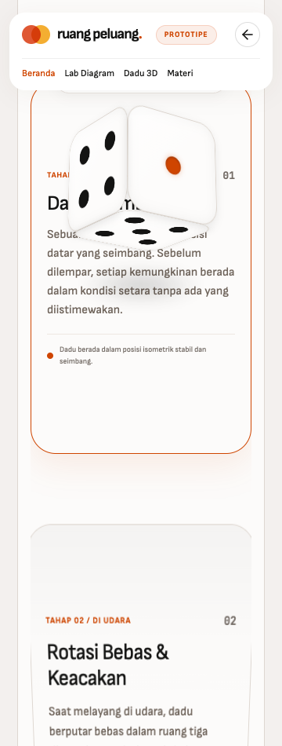 | Prototipe dadu 3D, 360 px |
| 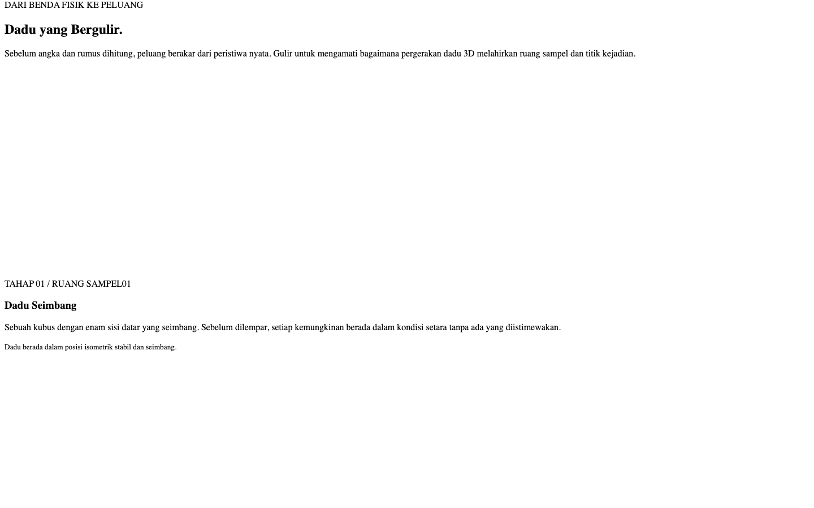 | Tahap 1 dari 4 pada gulir dadu |
| 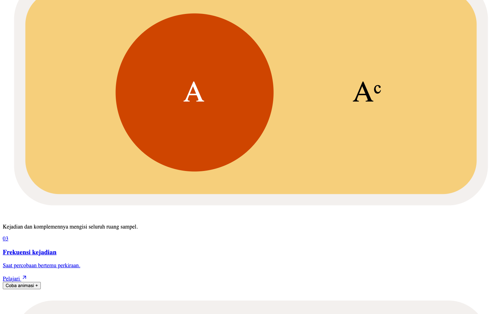 | Tahap 4 dari 4 pada gulir dadu |

Tangkapan layar lain (tablet 768 px, ponsel 375 px, tahap gulir 2 dan 3) tercantum di Lampiran G.

Fitur yang dapat dicoba pada prototype: menu jangkar, lab Venn, pratinjau materi, lima halaman materi, dan eksperimen. Bagian yang saat itu masih perlu diperbaiki tercatat di 4.4 dan 4.5.

## 4.4 Kendala yang Ditemui
| Kendala | Penanganan |
|---|---|
| Instalasi pertama terkendala DNS sandbox dan *timeout* npm | Akses jaringan diizinkan dan instalasi diulang dari cache |
| Audit awal menemukan dependensi lama | KaTeX diperbarui ke 0.19.0 dan Vitest ke 5.0.5; audit instalasi mencatat 0 kerentanan |
| Build pertama memerlukan jaringan untuk font Google | Font dipaketkan lewat `next/font`; runtime tidak meminta Google Fonts |
| Efek 3D berisiko berat dan sulit dibuat ramah gerak | Dipilih CSS 3D (bukan WebGL), terhubung ke mode Tenang dan *reduced motion* |
| Grafik frekuensi pada pratinjau beranda hanya ilustrasi tren, bukan data | Dicatat jelas di dokumen revisi; data nyata ada pada eksperimen koin di halaman materi |
| Uji peramban hanya di Chrome | Tetap menjadi keterbatasan (lihat 6.6) |

## 4.5 Masukan dan Rencana Perbaikan
- **Masukan guru terhadap prototype:** **[ISI: tanggal dan isi masukan guru; belum ada yang tercatat di berkas proyek]**.
- **Masukan dari pemeriksaan internal** terhadap *Pedoman Final Project* dan lembar materi guru (27 Oktober 2026): halaman referensi dan kredit sumber belum ada; tiga latihan belum ada di situs; beberapa rumus pada lembar materi belum tampil (batas 0–1 dengan mustahil/pasti, bentuk persen, rumus saling lepas, perkalian saling bebas, rumus bersyarat); laporan baru sampai Pertemuan 1.
- **Rencana perbaikan:** seluruhnya dikerjakan pada Pertemuan 4–5 (lihat 5.4 dan 6.3).

---

# BAB V — VALIDASI MATERI (PERTEMUAN 4)

## 5.1 Proses Pemeriksaan
1. **Pembandingan dengan lembar materi guru.** Setiap butir lembar *Peluang Suatu Kejadian* (percobaan dan ruang sampel, peluang kejadian, komplemen, frekuensi relatif, frekuensi harapan, saling lepas, tidak saling lepas, saling bebas, bersyarat, tiga latihan) dicocokkan dengan isi lima materi (hasil di 5.3).
2. **Pembandingan dengan sumber tepercaya.** Halaman OpenStax 3.1 dan 3.2 serta halaman repositori Kemendikbud dibuka pada 27 Oktober 2026 dan dicocokkan dengan konsep yang dikutip (status di 5.2).
3. **Pemeriksaan otomatis** (`npm test`, 114 tes pada 7 berkas):
   - aturan penjumlahan P(A ∪ B) = P(A) + P(B) − P(A ∩ B) dibuktikan untuk **semua 4.096 pasangan** himpunan bagian ruang sampel dadu;
   - ketiga jawaban latihan dihitung ulang **tanpa rumus**: mengenumerasi 15 bola, 52 kartu, dan 5.040 susunan duduk (dengan satu orang dikunci agar putaran tidak terhitung ganda), lalu hasilnya dibandingkan dengan 11/15, 2/13, dan 1/35;
   - rumus yang wajib ada pada tiap materi diperiksa teksnya, dan setiap sumber yang dikutip harus terdaftar;
   - contoh bersyarat (3/10) ÷ (3/5) = 2/4 diperiksa.
4. **Pemeriksaan tampilan rumus**: semua rumus KaTeX pada delapan halaman isi (beranda, lima materi, latihan, referensi) dirender tanpa galat (`npm run test:final`).

## 5.2 Daftar Sumber
| ID | Sumber | Status | Yang diperiksa |
|---|---|---|---|
| lembar-guru | Guru mata pelajaran Matematika. *Peluang Suatu Kejadian (lembar materi dan latihan soal)*. Berkas PDF dari guru | Isi diperiksa | Dibandingkan butir demi butir dengan situs (5.3) |
| openstax-3-1 | Illowsky & Dean (2023). *Introductory Statistics 2e, 3.1 Terminology*. OpenStax | Isi diperiksa | Halaman dibuka 27 Okt 2026: ruang sampel, kejadian, peluang klasik, batas 0–1, komplemen, frekuensi relatif jangka panjang |
| openstax-3-2 | Illowsky & Dean (2023). *Introductory Statistics 2e, 3.2 Independent and Mutually Exclusive Events*. OpenStax | Isi diperiksa | Halaman dibuka 27 Okt 2026: P(A ∩ B) = P(A)P(B), P(A ∩ B) = 0 untuk saling lepas, perbedaan saling lepas dan saling bebas |
| kemdikbud-2019 | Supriyati (2019). *E-modul matematika kelas XII: peluang kejadian majemuk*. Kemendikbud | **Metadata diperiksa** | Judul, penulis, tahun, dan ringkasan di repositori diperiksa; **isi PDF belum dibaca penuh** |

Hasil penting dari pemeriksaan sumber: halaman OpenStax 3.2 **tidak** memuat rumus penjumlahan untuk saling lepas dan tidak memuat P(B | A) sebagai definisi berdiri sendiri. Bagian itu karenanya hanya dikreditkan ke lembar guru dan e-modul Kemendikbud, bukan ke OpenStax.

## 5.3 Hasil Pemeriksaan
| Butir lembar guru | Kondisi sebelum validasi | Penilaian |
|---|---|---|
| Percobaan, ruang sampel, titik sampel, kejadian | Ada di materi 1 | Sesuai |
| P(A) = n(A)/n(S) | Ada di materi 2 | Sesuai |
| 0 ≤ P(A) ≤ 1; 0 mustahil, 1 pasti | Hanya "antara 0 dan 1" | **Kurang jelas** — mustahil dan pasti tidak disebut |
| Peluang komplemen | Ada | Sesuai |
| Frekuensi relatif | Pecahan saja | **Kurang jelas** — bentuk persen tidak ada |
| Frekuensi harapan | Ada | Sesuai |
| Saling lepas | Hanya disinggung dalam contoh | **Kurang jelas** — tanpa definisi dan rumus sendiri |
| Tidak saling lepas | Ada | Sesuai |
| Saling bebas | Hanya kalimat P(B \| A) = P(B) | **Kurang jelas** — rumus perkalian tidak tampil |
| Kejadian bersyarat | Hanya bentuk perkalian | **Kurang jelas** — P(B \| A) = P(A ∩ B)/P(A) tidak tampil |
| Tiga soal latihan | Tidak ada di situs | **Belum ada** |
| Rumus saling lepas pada lembar: "n(A ∩ B) ≠ 0" | — | **Salah ketik pada sumber.** Yang benar n(A ∩ B) = 0 (A ∩ B = ∅). Situs memakai bentuk yang benar |
| Sumber untuk teks, diagram, dan data | Data sitasi ada tetapi tidak tampil di situs | **Belum ada** |

## 5.4 Revisi yang Dilakukan
| Temuan | Revisi | Berkas |
|---|---|---|
| Batas peluang | Rumus 0 ≤ P(A) ≤ 1 ditambahkan; mustahil (himpunan kosong, mis. angka 7 pada dadu) dan pasti (seluruh S) dijelaskan | `lib/materials.ts` |
| Frekuensi relatif | Bentuk persen F_r = f/n × 100% dan contoh 47% ditambahkan | `lib/materials.ts` |
| Saling lepas | Definisi (A ∩ B = ∅, n(A ∩ B) = 0) dan rumus P(A ∪ B) = P(A) + P(B) ditambahkan di samping rumus tidak saling lepas | `lib/materials.ts` |
| Saling bebas dan bersyarat | Tiga rumus berlabel; contoh diberi pemeriksaan (3/10) ÷ (3/5) = 2/4 dan kasus dengan pengembalian | `lib/materials.ts` |
| Tampilan rumus | Rumus kini berupa daftar kartu berlabel, bukan satu rumus per materi | `app/materi/[slug]/page.tsx`, `app/globals.css` |
| Tiga latihan | Halaman `/latihan` dengan pembahasan langkah demi langkah; konvensi meja bundar dinyatakan; tautan dari materi terkait | `lib/exercises.ts`, `app/latihan/page.tsx` |
| Sumber | Halaman `/referensi`, blok "Sumber" pada setiap materi dan latihan, status pemeriksaan, catatan koreksi | `lib/citations.ts`, `app/referensi/page.tsx`, `components/SourceCredits.tsx` |
| Navigasi | Latihan dan Referensi masuk menu header dan footer | `components/Experience.tsx`, `components/SiteChrome.tsx` |
| Pengujian | Tes isi (jawaban latihan, rumus wajib, sumber) | `tests/content.test.ts` |

**Revisi berdasarkan masukan guru:** **[ISI: catat setiap masukan guru dan perubahan yang dilakukan; belum ada yang tercatat]**.

---

# BAB VI — HASIL AKHIR / FINAL PROJECT (PERTEMUAN 5)

## 6.1 Deskripsi Website Final
Ruang Peluang adalah website pembelajaran berbahasa Indonesia untuk topik peluang. Pengguna memulai dari beranda (dadu 3D dan lab Venn), memilih salah satu dari lima materi, mencoba eksperimen, membaca rumus berlabel dan contoh, menjawab pertanyaan, lalu mengerjakan tiga latihan. Setiap materi dan latihan mencantumkan sumbernya, dan seluruh sumber dirinci di halaman referensi.

## 6.2 Tautan Website atau Lokasi File
- Tautan publikasi: **[ISI: URL website jika sudah dipublikasikan]**. Saat laporan ini disusun website **belum dipublikasikan**.
- Lokasi file: folder proyek `ruang-peluang` (kode sumber lengkap). Menjalankan:

```sh
npm install
npm run dev        # lalu buka http://127.0.0.1:3000
```
Untuk versi produksi: `npm run build`, kemudian `npm run start`.

## 6.3 Fitur Final
| Fitur | Jumlah / keterangan |
|---|---|
| Halaman | Beranda, 5 materi, Latihan, Referensi (ditambah Styleguide dan Prototype untuk pengembang) |
| Eksperimen interaktif | 5 (satu per materi), juga dapat dibuka dari daftar materi di beranda |
| Lab Venn | 2 skenario × 3 daerah (gabungan, irisan, komplemen) |
| Rumus berlabel | 13 rumus pada 5 materi, dirender KaTeX |
| Latihan | 3 soal, masing-masing dengan pembahasan langkah demi langkah dan konsep terkait |
| Sumber | 4 sumber; setiap materi dan latihan menautkan ke entri referensinya |
| Aksesibilitas | Tautan lewati navigasi, label ARIA pada diagram, tombol dengan status `aria-pressed`, hasil dibacakan (`aria-live`), kontrol keyboard, Mode tampilan, dan dukungan *reduced motion* |
| Responsif | Diuji pada 1440, 768, dan 375 px |

## 6.4 Hasil Pengujian
Pengujian dijalankan pada build produksi (`npm run build`, lalu `npm run start`) dengan `npm run test:final`; hasil mentah tersimpan di `docs/pengujian-final.json`. Tanggal pengujian: 27 Oktober 2026.

| Aspek | Cara uji | Hasil |
|---|---|---|
| Navigasi | Semua tautan menu header dan footer pada 8 halaman isi | Lulus |
| Tautan | 19 tautan internal unik dibuka | Semua berstatus 200 |
| Jangkar | 10 tautan berjangkar (`/#lab`, `/#materi`, `/latihan#soal-1..3`, `/referensi#…`) diperiksa keberadaan targetnya | Semua ada |
| Halaman tidak ada | `/materi/tidak-ada` | 404 sesuai harapan |
| Tampilan | 8 halaman × 3 lebar (1440, 768, 375 px) = 24 kombinasi | Tidak ada *overflow* mendatar |
| Rumus | Semua rumus KaTeX pada 8 halaman | Tidak ada galat render |
| Galat JavaScript | Seluruh kunjungan halaman | 0 galat |
| Materi | Perbandingan dengan lembar guru dan sumber (Bab V); 114 tes otomatis pada 7 berkas | Lulus |
| Kualitas kode | `npm run typecheck`, `npm run lint` | Lulus; 0 galat lint |
| Build | `npm run build` | Lulus; 12 halaman statis dibuat |
| Gambar | Situs tidak memuat berkas gambar; ilustrasi berupa SVG/CSS | Tidak ada gambar rusak |
| **Ejaan** | — | **Belum diperiksa secara sistematis.** **[ISI: hasil baca ulang ejaan oleh anggota/guru]** |
| Peramban dan perangkat | Chromium (Playwright) dan peramban dalam aplikasi, ukuran layar lewat emulasi | Safari, Firefox, dan perangkat fisik **belum** diuji |

Skrip Playwright tahap awal (`tests/browser.mjs`, `tests/homepage.mjs`, `tests/prototype.mjs`) sudah diperbarui untuk menu enam tautan tetapi **belum dijalankan ulang** pada tahap ini; tahap awal mencatat lulus (lihat `docs/VERIFIKASI.md`).

## 6.5 Dokumentasi
Tangkapan layar halaman final (halaman penuh, *reduced motion*). Ukuran tablet 768 px tersedia di Lampiran G. Pada beranda 1440 px, ruang kosong lebar di sekitar dadu terjadi karena bagian dadu 3D bersifat *sticky* dan tampil utuh hanya saat digulir.

| Halaman | Desktop 1440 px | Ponsel 375 px |
|---|---|---|
| Beranda | 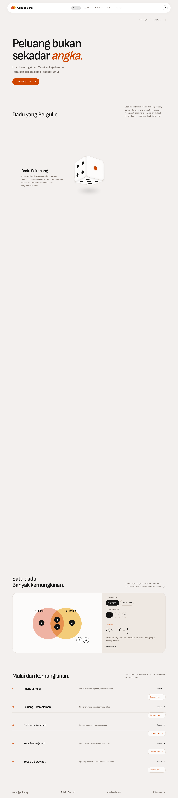 | 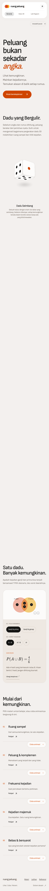 |
| Materi (Kejadian majemuk) | 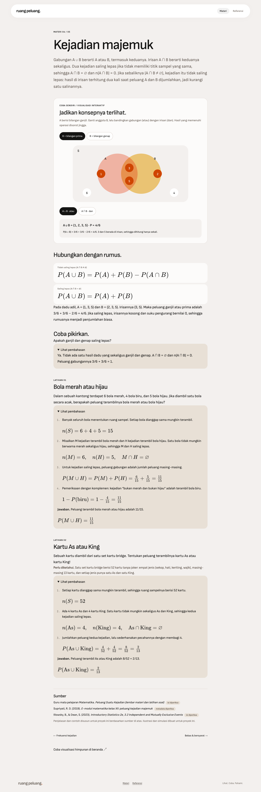 | 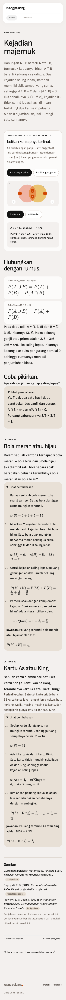 |
| Latihan (pembahasan terbuka) | 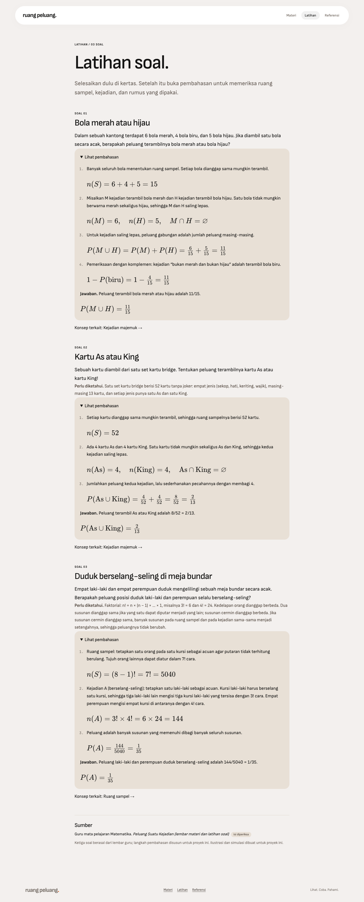 | 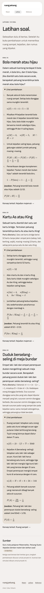 |
| Referensi | 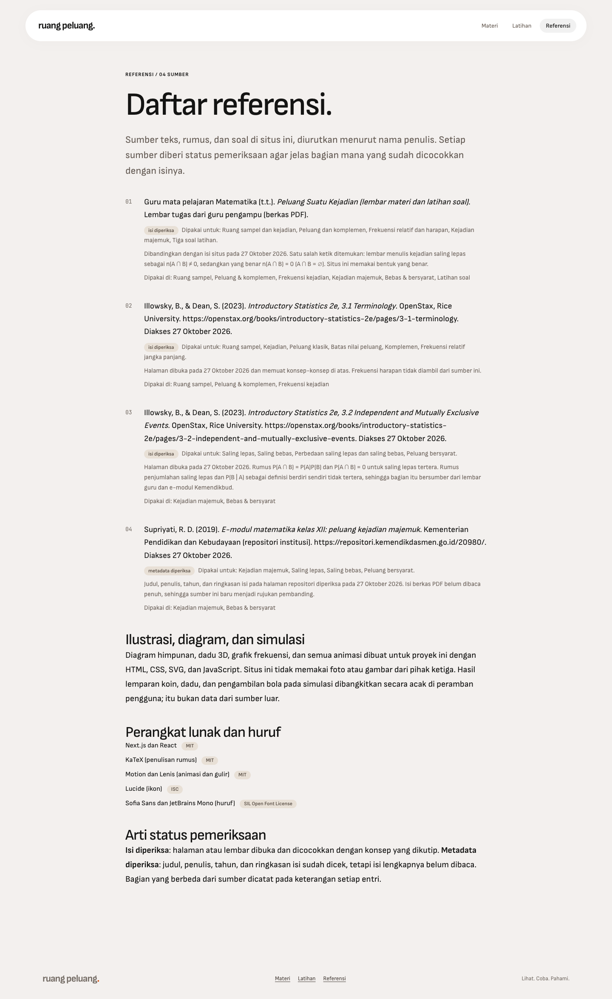 | 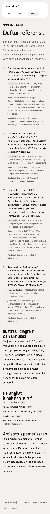 |

## 6.6 Evaluasi
**Yang berhasil**
- Struktur lengkap: beranda, lima materi, latihan, referensi, dan navigasi konsisten di semua halaman.
- Materi diperiksa terhadap lembar guru dan sumber luar; satu salah ketik pada sumber ditemukan dan dikoreksi.
- Jawaban latihan dibuktikan dengan enumerasi, bukan hanya rumus.
- Setiap sumber memiliki status pemeriksaan yang jujur, termasuk yang baru sebatas metadata.
- Pengujian dapat diulang dengan perintah yang sama dan memberi bukti tertulis.

**Yang masih perlu dikembangkan**
- Isi PDF e-modul Kemendikbud belum dibaca penuh; sumber itu masih rujukan pembanding.
- Belum ada masukan, validasi, atau persetujuan guru yang tercatat, dan belum ada uji coba dengan siswa.
- Ejaan belum diperiksa sistematis; pengujian peramban baru Chromium, belum Safari, Firefox, atau perangkat fisik.
- Skrip Playwright tahap awal belum dijalankan ulang setelah penambahan halaman.
- Belum ada kuis berskor, pencarian, atau tautan menu ke unduhan laporan.
- Belum dipublikasikan; sebagian informasi identitas masih kosong.
- Wireframe disusun setelah situs dibangun, bukan sebagai rancangan awal.

---

# BAB VII — PENUTUP

## 7.1 Kesimpulan
Proyek menghasilkan website pembelajaran peluang yang terencana, mudah dinavigasi, dan memuat lima materi dengan eksperimen interaktif, rumus berlabel, serta tiga latihan berpembahasan. Materi diperiksa terhadap lembar guru dan sumber luar; kekurangan yang ditemukan (rumus yang belum tampil, latihan yang belum ada, sumber yang tidak terlihat) telah direvisi, dan satu salah ketik pada sumber dikoreksi. Hasil pengujian otomatis menunjukkan seluruh halaman dan tautan berfungsi pada tiga ukuran layar. Validasi oleh guru, pemeriksaan ejaan, dan pengujian pada lebih banyak peramban masih perlu dilengkapi sebelum pengumpulan.

## 7.2 Saran
1. Mintakan guru meninjau materi, rumus, dan tiga pembahasan; catat masukannya pada Bab IV–V.
2. Baca isi PDF e-modul Kemendikbud dan perbarui statusnya dari metadata ke isi diperiksa.
3. Tambahkan kuis berskor dengan alasan jawaban, lalu uji dengan beberapa siswa.
4. Publikasikan website dan jalankan ulang `npm run test:final` pada alamat publikasi.
5. Uji pada Safari, Firefox, dan ponsel fisik; periksa ejaan seluruh halaman.
6. Tambahkan tautan unduhan laporan pada menu dan jalankan ulang skrip Playwright tahap awal.

---

# DAFTAR PUSTAKA

Guru mata pelajaran Matematika. (t.t.). *Peluang Suatu Kejadian (lembar materi dan latihan soal)* [Berkas PDF lembar tugas]. **[ISI: nama guru dan tahun jika tersedia]**.

Illowsky, B., & Dean, S. (2023). *Introductory Statistics 2e, 3.1 Terminology*. OpenStax, Rice University. https://openstax.org/books/introductory-statistics-2e/pages/3-1-terminology. Diakses 27 Oktober 2026.

Illowsky, B., & Dean, S. (2023). *Introductory Statistics 2e, 3.2 Independent and Mutually Exclusive Events*. OpenStax, Rice University. https://openstax.org/books/introductory-statistics-2e/pages/3-2-independent-and-mutually-exclusive-events. Diakses 27 Oktober 2026.

Supriyati, R. D. (2019). *E-modul matematika kelas XII: peluang kejadian majemuk*. Kementerian Pendidikan dan Kebudayaan. https://repositori.kemendikdasmen.go.id/20980/. Diakses 27 Oktober 2026.

**Perangkat lunak dan huruf** (tanpa gambar atau foto pihak ketiga): Next.js dan React (MIT); KaTeX (MIT); Motion dan Lenis (MIT); Lucide (ISC); Sofia Sans dan JetBrains Mono (SIL Open Font License).

---

# LAMPIRAN

## Lampiran A — Dokumentasi Pertemuan
Dokumen tertulis per tahap: `docs/DRAF_PERTEMUAN_1.md` (Pertemuan 1), bab III pada laporan ini (Pertemuan 2), `docs/REVISI_HOMEPAGE.md` dan `docs/plans/3d-scrolling-effect.plan.md` (Pertemuan 3), `docs/VERIFIKASI.md` dan `docs/pengujian-final.json` (Pertemuan 5). Foto atau catatan kegiatan kelas: **[ISI: lampirkan dokumentasi kegiatan di kelas]**.

## Lampiran B — Sketsa/Wireframe
Lihat 3.4. Sketsa tangan atau berkas desain asli: **[ISI: lampirkan jika ada]**.

## Lampiran C — Pembagian Tugas Anggota
| Anggota | Tugas | Pertemuan |
|---|---|---|
| **[ISI: nama]** | **[ISI: tugas]** | **[ISI]** |
| **[ISI: nama]** | **[ISI: tugas]** | **[ISI]** |

## Lampiran D — Lembar Catatan Setiap Pertemuan
"Tanggal pengerjaan" diambil dari tanggal berkas dan riwayat Git. "Tanggal pertemuan kelas" tidak ada di berkas proyek dan harus diisi.

| Pertemuan / Tanggal | Target Kegiatan | Hasil yang Dicapai | Kendala dan Tindak Lanjut |
|---|---|---|---|
| 1. Perencanaan materi — kelas: **[ISI]**; pengerjaan: 23 Okt 2026 | Memilih topik, alasan, sasaran, tujuan, submateri, sumber awal | `DRAF_PERTEMUAN_1.md`, BAB I–II, fondasi Next.js/TypeScript, token desain, `/styleguide`, Venn dadu; 6 tes awal lulus | Identitas belum diberikan; audit isi sumber belum selesai → dilengkapi pada Pertemuan 4 |
| 2. Konsep dan desain — kelas: **[ISI]**; pengerjaan: 27 Okt 2026 | Nama, tujuan, pengguna, sitemap, wireframe, warna dan huruf, navigasi | BAB III: sitemap, wireframe, tabel desain visual, rancangan navigasi | Wireframe disusun setelah situs dibangun (bukan rancangan awal) → dicatat terbuka di Bab III |
| 3. Prototype — kelas: **[ISI]**; pengerjaan: 23 Okt (revisi beranda) dan 27 Okt 2026 (riwayat Git) | Prototype dengan tangkapan layar dan daftar fitur | Beranda, lima rute materi, eksperimen, prototipe 3D, 7 komit; BAB IV dan tangkapan layar | Masukan guru belum tercatat; grafik pratinjau hanya ilustrasi → data nyata ada pada eksperimen |
| 4. Validasi materi — kelas: **[ISI]**; pengerjaan: 27 Okt 2026 | Memeriksa ketepatan, kejelasan, sumber; merevisi | Pembandingan dengan lembar guru dan sumber; 9 revisi; tes isi (114 tes); BAB V | Isi PDF Kemendikbud belum dibaca; belum ada validasi guru → saran 7.2 |
| 5. Final project — kelas: **[ISI]**; pengerjaan: 27 Okt 2026 | Menguji tautan, navigasi, tampilan, keterbacaan, fitur; menyusun laporan | `test:final`: 24 kombinasi tampilan, 19 tautan, 10 jangkar, 0 galat; BAB VI–VII | Ejaan belum diperiksa; belum dipublikasikan; Safari/Firefox belum diuji |

## Lampiran E — Checklist Sebelum Dikumpulkan
- [ ] Halaman judul dan identitas lengkap — **belum**: identitas bertanda [ISI]
- [x] Lima tahap/pertemuan dijelaskan dalam laporan
- [x] Materi website tersusun jelas dan sesuai topik
- [x] Konsep, sitemap, dan wireframe/sketsa dilampirkan — wireframe berupa diagram teks yang disusun ulang
- [x] Prototype disertai tangkapan layar
- [x] Keabsahan materi diperiksa dan sumber dicantumkan — satu sumber masih sebatas metadata; belum ada validasi guru
- [ ] Website final dapat dibuka atau file proyek disertakan — file proyek ada; tautan publikasi **belum**
- [ ] Navigasi, tautan, gambar, dan ejaan telah diuji — navigasi, tautan, dan tampilan **sudah**; ejaan **belum**
- [x] Kesimpulan, saran, daftar pustaka, dan lampiran tersedia
- [ ] Pembagian tugas anggota dicantumkan jika berkelompok — **belum** (Lampiran C)

## Lampiran F — Koreksi Matematika
Saling lepas berarti n(A ∩ B) = 0 (A ∩ B = ∅). Kejadian adalah himpunan bagian S, termasuk kemungkinan A = S dan A = ∅. Diagram Venn menyatakan keanggotaan, bukan luas proporsional peluang. Ganjil dan prima pada dadu beririsan {3, 5} dan gabungannya {1, 2, 3, 5}; ganjil dan genap saling lepas. Saling bebas berbeda dari saling lepas. Pada meja bundar, susunan yang dapat diputar dianggap sama; peluang 1/35 tidak berubah jika susunan cermin dianggap sama.

## Lampiran G — Daftar Tangkapan Layar
- **Fondasi (Pertemuan 1):** `foundation-1440/768/360.png`, `styleguide-1440.png`
- **Beranda dan prototype (Pertemuan 3):** `homepage-1440/768/360.png`, `homepage-hover-1440.png`, `current-homepage.png`, `prototype-top-1440.png`, `prototype-scroll-1440.png`, `prototype-3d-folding-1440/768/360.png`
- **Gulir dadu 3D:** `scrolly-1440-stage1..4.png`, `scrolly-768-stage1..4.png`, `scrolly-375-stage1..4.png`, `scrolly-stage-1..3.png`, `scrolly-paced-stage1..2.png`, `clean-scrolly-*.png`, `current-scrolly-*.png`, `mobile-scrolly-*.png`, `continued-dice-*.png`, `kept-lab-part.png`
- **Final (Pertemuan 5):** `final-{beranda,materi,latihan,referensi}-{1440,768,375}.png`

Semua berkas berada di `docs/screenshots/`.

## Lampiran H — Isian yang Masih Harus Dilengkapi
| Bagian | Yang diisi |
|---|---|
| Halaman judul | Nama kelompok/siswa, anggota dan kelas, guru, tahun pelajaran, sekolah |
| 1.6 dan Lampiran C | Individu atau kelompok; pembagian tugas |
| 2.1 | Persetujuan topik oleh guru |
| 4.5 dan 5.4 | Masukan guru dan revisi yang dilakukan karenanya |
| 6.2 | URL publikasi (jika ada) |
| 6.4 | Hasil pemeriksaan ejaan |
| Daftar pustaka | Nama guru dan tahun lembar materi (jika tersedia) |
| Lampiran A, B, D | Dokumentasi kelas, sketsa asli, tanggal pertemuan kelas |

## Lampiran I — Riwayat Perubahan (Git)
| Komit | Tanggal | Isi |
|---|---|---|
| `90e87e0` | 2026-10-27 | Mengimpor baseline Ruang Peluang v0.1 (fondasi, beranda, materi, prototipe) |
| `5310300` | 2026-10-27 | Animasi lab dan eksperimen materi (gerak tingkat 1) |
| `fc9f29e` | 2026-10-27 | Menghapus label dekoratif dari beranda |
| `b586736` | 2026-10-27 | Merapikan kode agar sesuai aturan hooks React |
| `ba2cd57` | 2026-10-27 | Menambah ESLint dan cakupan Vitest |
| `f079ed2` | 2026-10-27 | Animasi masuk halaman, transisi rute, gerak tingkat 2 |
| `4ea891c` | 2026-10-27 | Menyempurnakan gerak dan memindahkannya ke GPU |

Perubahan Pertemuan 4–5 (halaman Latihan dan Referensi, rumus, sumber, tes isi, `tests/final.mjs`, laporan ini) **belum di-commit** saat laporan disusun.

## Lampiran J — Cara Menjalankan dan Menguji
```sh
npm install
npm run dev            # pengembangan: http://127.0.0.1:3000
npm test               # 114 tes unit (7 berkas)
npm run typecheck
npm run lint
npm run build
npx next start -p 3200 --hostname 127.0.0.1    # server produksi
BASE_URL=http://127.0.0.1:3200 npm run test:final   # tampilan, tautan, jangkar, galat; tangkapan layar final
```
`npm run lint` melaporkan 0 galat; peringatan yang muncul berasal dari skrip pihak ketiga di folder `.claude/skills`, bukan dari kode website.
