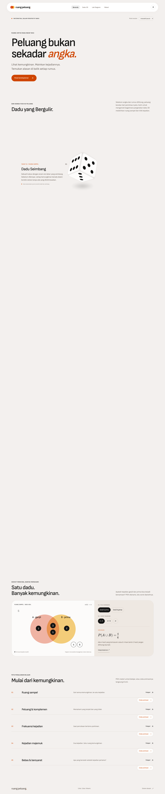
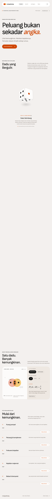
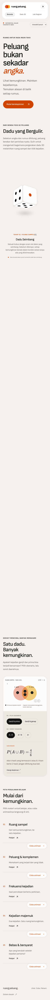
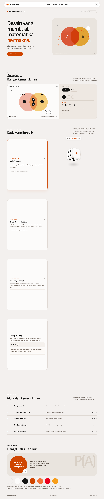

# Verifikasi

## Pertemuan 4–5 — 27 Oktober 2026
- `npm test`: 114 tes lulus pada 7 berkas. Tes isi (`tests/content.test.ts`) menghitung ulang ketiga jawaban latihan dengan enumerasi (15 bola, 52 kartu, 5.040 susunan duduk), memeriksa rumus wajib pada tiap materi, dan memastikan setiap sumber yang dikutip terdaftar.
- `npm run typecheck` dan `npm run lint` lulus (0 galat; peringatan hanya dari skrip pihak ketiga di `.claude/skills`). `npm run build` lulus: 12 halaman statis (`/`, `/latihan`, `/referensi`, 5 rute `/materi/*`, `/prototype`, `/styleguide`).
- `npm run test:final` pada build produksi (port 3200): 8 halaman × 3 lebar (1440, 768, 375) tanpa overflow mendatar dan tanpa galat render rumus; 19 tautan internal berstatus 200; 10 tautan berjangkar menemukan targetnya; `/materi/tidak-ada` mengembalikan 404; 0 galat JavaScript. Hasil mentah: `docs/pengujian-final.json`. Tangkapan layar: `docs/screenshots/final-*.png`.
- Sumber diperiksa 27 Oktober 2026: halaman OpenStax 3.1 dan 3.2 dibuka dan dicocokkan dengan konsep yang dikutip; halaman repositori Kemendikbud diperiksa metadatanya. Halaman OpenStax 3.2 tidak memuat rumus penjumlahan saling lepas, sehingga bagian itu tidak dikreditkan ke OpenStax. Lembar guru memuat satu salah ketik (saling lepas ditulis n(A ∩ B) ≠ 0); situs memakai n(A ∩ B) = 0.

### Batas verifikasi tahap ini
- `tests/browser.mjs`, `tests/homepage.mjs`, dan `tests/prototype.mjs` sudah diperbarui untuk menu enam tautan tetapi belum dijalankan ulang: skrip itu memakai port 3000 (sedang dipakai proses lain) dan menimpa tangkapan layar tahap awal.
- Hanya Chromium (Playwright) dan peramban dalam aplikasi, dengan ukuran layar lewat emulasi. Belum ada uji Safari, Firefox, perangkat fisik, atau pembaca layar.
- Ejaan belum diperiksa sistematis. Isi PDF e-modul Kemendikbud belum dibaca penuh. Belum ada validasi guru atau uji coba dengan siswa.

## Phase 0 & Pertemuan 1 — 23 Oktober 2026

- `npm test`: 6 tes lulus, termasuk aturan gabungan pada seluruh 4.096 pasangan himpunan dadu, komplemen, input ilegal, dan metadata sitasi.
- `npm run typecheck`: lulus. Pemeriksaan TypeScript juga lulus dalam build produksi.
- `npm run build`: lulus untuk `/` dan `/styleguide`.
- `node tests/browser.mjs`: Chrome headless, ukuran 1440 × 1000, 768 × 1000, dan 360 × 1000. Tidak ada overflow horizontal atau galat JavaScript. Gabungan, irisan, komplemen, pergantian skenario, mode fokus, styleguide, dan unduhan Markdown diperiksa.
- Pembaruan KaTeX 0.19.0 dan Vitest 5.0.5: hasil audit instalasi mencatat 0 kerentanan.
- Tangkapan layar desktop dan ponsel ditinjau secara visual. Screenshot full-page menggambarkan tinggi seluruh dokumen, bukan tinggi viewport.

## Bukti visual fondasi

## Batas verifikasi
Uji browser dilakukan pada Chrome saja, belum Safari/Firefox. Belum dilakukan uji pengguna, audit pembaca layar, pemeriksaan semua klaim sumber, atau penilaian guru. Tes sitasi hanya memvalidasi metadata dasar, bukan kebenaran akademik. Belum ada pengujian modul yang memang dijadwalkan pada pertemuan berikutnya.

## Kendala dan penanganan
Instalasi pertama terkendala DNS sandbox dan timeout npm. Akses jaringan yang diizinkan serta pengulangan dari cache menyelesaikan instalasi. Audit awal menemukan dependensi lama; versi KaTeX dan Vitest diperbarui, lalu tes dan build diulang. Font berhasil dipaketkan melalui next/font agar runtime tidak bergantung pada permintaan Google Fonts.
