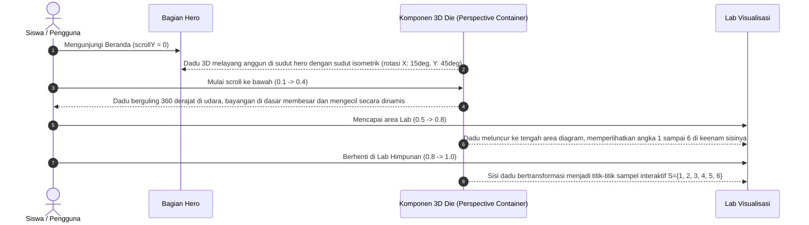

# Rencana Implementasi: Efek 3D Scrolling (Scrollytelling 3D) — Ruang Peluang

## Ringkasan Eksekutif
Fitur ini menambahkan pengalaman **3D Scrollytelling interaktif** pada beranda [Ruang Peluang](file:///Users/sada/Documents/Codex/2026-10-23/files-pasted-by-the-user-master/outputs/ruang-peluang). Konsep utamanya adalah menghadirkan **Dadu 3D Taktil (Tactile 3D Die)** yang bergulir dan berputar secara mulus mengikuti posisi scroll pengguna dari bagian **Hero** menuju **Lab Eksplorasi**, lalu mendarat dan membuka permukaannya secara mulus menjadi diagram himpunan 2D $n(S) = 6$.

Dengan pendekatan ini, efek 3D bukan sekadar hiasan visual (eye candy), melainkan jembatan pedagogis: mengaitkan benda fisik 3D (dadu acak) dengan konsep abstrak matematika (ruang sampel dan kejadian).

---

## 1. Pilihan Pendekatan Teknis (Architecture Decision)

Kami mengevaluasi 2 opsi arsitektur:

| Kriteria | Opsi A: `motion/react` + CSS 3D Transforms (Direkomendasikan) | Opsi B: WebGL / Three.js (`three` + `@react-three/fiber`) |
|---|---|---|
| **Ukuran Bundle** | **0 KB tambahan** (memanfaatkan `motion/react` v12 yang sudah terpasang) | +600 KB bundle size, overhead WebGL context |
| **Kompatibilitas React 19** | 100% kompatibel dan native | R3F sering mengalami peer dependency mismatch di React 19.2 |
| **Kinerja & 60fps** | GPU-accelerated via `transform: translate3d/rotate3d`, konsumsi baterai rendah | GPU intensif, potensi freeze pada perangkat seluler kelas menengah |
| **Aksesibilitas & Reduksi Gerak** | Mudah diintegrasikan dengan `useReducedMotion()` & mode Tenang/Fokus | Memerlukan canvas teardown manual |
| **Responsif & Overflow** | Sangat mudah dikontrol dalam kontainer flex/grid | Sering terjadi viewport stretch & clipping pada mobile |

> **Keputusan:** Menggunakan **Opsi A (`motion/react` v12 + CSS 3D Transforms)**. Menghasilkan visual 3D dadu isometrik berdefinisi tinggi, bayangan dinamis, performa 60fps native, dan zero-dependency footprint.

---

## 2. Alur Interaksi & Diagram Status

```mermaid
flowchart TD
  A[Hero Section: scrollY = 0%] -->|User scroll ke bawah| B[Transisi Antara Hero & Lab: scrollY 15% - 45%]
  B -->|Dadu 3D berguling & melayang dengan rotasi multi-axis| C[Lab Entrance: scrollY 50% - 75%]
  C -->|Dadu mendarat & sisi-sisinya membuka| D[Lab Section: scrollY > 75%]
  D -->|Transisi mulus ke diagram himpunan 2D interaktif n(S)=6| E[Eksplorasi Lab Selesai]

  subgraph Mode & Sensitivitas
    F[User aktifkan Mode Tenang/Fokus atau Reduced Motion] -.->|Bypass 3D scroll| G[Tampilan 2D Statis langsung aktif tanpa animasi scroll]
  end
```

---

## 3. Detail Visual 3D per Zona Scroll



### Visual Specifications
- **Perspective Canvas:** `perspective: 1000px` dengan `transform-style: preserve-3d`.
- **Die Cube Structure:** 6 sisi kubus (depan: 1, belakang: 6, atas: 2, bawah: 5, kanan: 3, kiri: 4) dengan titik pip die bergaya skandinavia minimalis beraksen `#141413` dan `#CF4500`.
- **Lighting & Depth:** Bayangan lantai kontak (`box-shadow` berlapis + filter blur lembut) yang mengecil saat dadu melayang naik dan menguat saat dadu mendarat.
- **Scroll Sync:** Menggunakan hook `useScroll({ target: containerRef, offset: ["start start", "end end"] })` dan `useTransform` untuk memetakan scroll progres ke:
  - Rotasi X: `[15deg, 375deg]`
  - Rotasi Y: `[45deg, 405deg]`
  - Posisi Y: `[0px, 320px]`
  - Skala & Kedalaman Z: `[1, 1.15, 0.95, 1.0]`

---

## 4. Rincian Berkas yang Dibuat & Dimodifikasi

1. **`components/ScrollDie3D.tsx` (Baru):**
   - Komponen kubus 3D mandiri dengan 6 sisi HTML/CSS.
   - Menggunakan `useScroll` dan `useTransform` dari `motion/react`.
   - Menghormati properti `quiet` (`useReducedMotion` atau mode non-`full`).
2. **`components/Experience.tsx` (Update):**
   - Mengintegrasikan `ScrollDie3D` di antara bagian Hero dan Lab.
   - Menjaga grid tata letak tetap stabil tanpa pergeseran tata letak kumulatif (CLS = 0).
3. **`app/globals.css` (Update):**
   - Token CSS khusus 3D: `--die-size: 80px;`, `@media (max-width: 760px) { --die-size: 56px; }`.
   - Kelas styling `.die-scene`, `.die-cube`, `.die-face`, `.die-shadow`.
   - Aturan khusus `@media (prefers-reduced-motion)` untuk menonaktifkan transform 3D.
4. **`tests/homepage.mjs` & `tests/browser.mjs` (Update):**
   - Menambahkan verifikasi scroll 3D: memastikan tidak ada overflow horizontal (`scrollWidth <= innerWidth`) pada semua ukuran layar (360px, 768px, 1440px).

---

## 5. Pertimbangan Aksesibilitas & Performa

- **No Motion Sickness / Vestibular Protection:**
  Bila pengguna mengaktifkan OS `prefers-reduced-motion: reduce` atau memilih mode **Tenang** / **Fokus ujian** pada select dropdown, dadu 3D ditampilkan dalam keadaan diam (posisi akhir statis) atau disembunyikan tanpa rotasi scroll.
- **Strict Zero-Overflow:**
  Dadu 3D dibungkus dalam container dengan `overflow: clip` sehingga rotasi diagonal tidak menyebabkan scroll horizontal pada layar ponsel (360px).
- **Semantik & Screen Readers:**
  Komponen 3D ditandai dengan `aria-hidden="true"` karena bersifat visualisasi pelengkap; seluruh informasi matematis tetap tersedia secara semantik di diagram dan teks penjelasan.

---

## 6. Rencana Tahapan Kerja (Phased Rollout)

- [ ] **Fase 1: Pembangunan Komponen `ScrollDie3D.tsx`**
  - Buat kubus CSS 3D dengan 6 muka titik dadu yang akurat (pasangan berlawanan berjumlah 7: 1-6, 2-5, 3-4).
- [ ] **Fase 2: Pemetaan Transform Scroll & Bayangan Dinamis**
  - Hubungkan rotasi dan translasi dengan `useScroll` dan `useTransform`.
  - Tambahkan bayangan radial di bawah dadu yang merespons ketinggian Z.
- [ ] **Fase 3: Integrasi Tata Letak di `Experience.tsx` & Responsivitas**
  - Posisikan di antara Hero dan Lab.
  - Uji adaptasi ukuran pada viewport mobile (360px), tablet (768px), dan desktop (1440px).
- [ ] **Fase 4: Verifikasi & Pengujian Otomatis**
  - Jalankan `npm run typecheck`, `npm test`, dan `npm run test:e2e`.
  - Pastikan 0 galat TypeScript, 0 kerentanan keamanan, dan tidak ada overflow horizontal.

---

## 7. Pertanyaan untuk Pengguna (Feedback Gate)

Sebelum memulai implementasi kode, silakan tinjau rencana di atas pada Plan Canvas interaktif:
1. Apakah Anda lebih menyukai dadu 3D berada di **tengah alur scroll (antara Hero dan Lab)**, atau melayang di **sisi kanan Hero** terus menerus saat di-scroll?
2. Apakah Anda ingin sisi dadu dapat diklik (klik untuk melempar/roll manual di tempat)?
